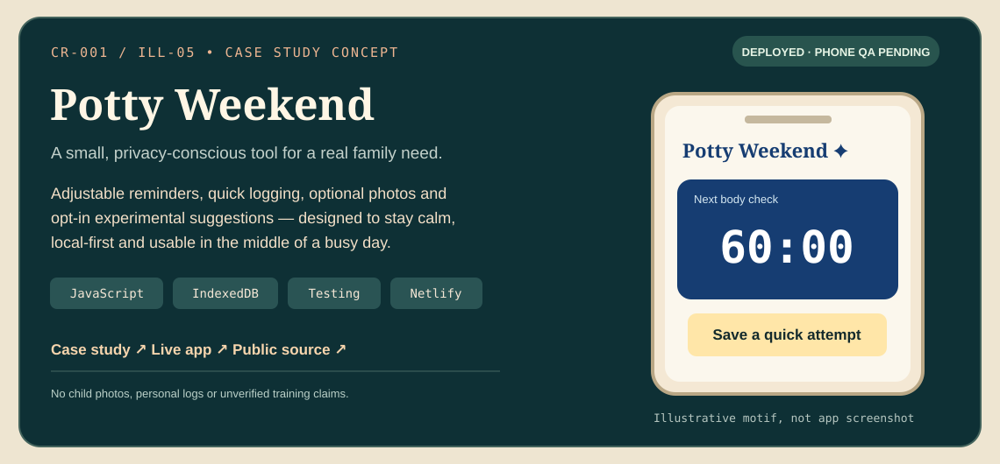
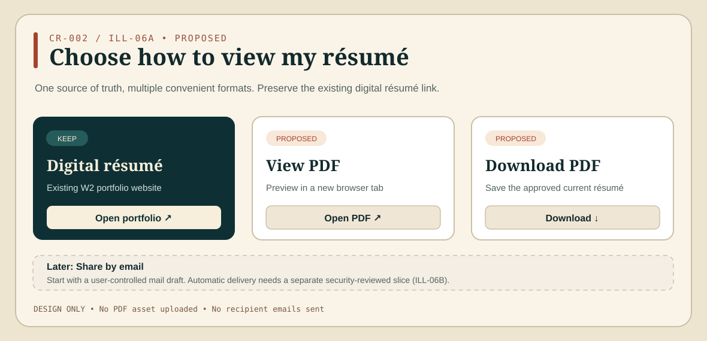
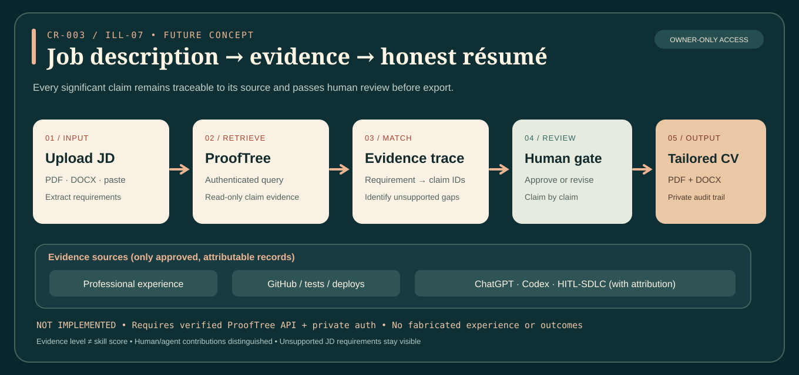

# Illustrated Portfolio — Slices

_Last reviewed: 2026-10-23 (CR-003 / future ILL-07 added; earlier slice statuses retain their recorded scope)_

## Slice operating rules

- One small, testable vertical slice at a time. Planning a slice does **not** authorize implementation, merges, production cutover, private-repository exposure, or changing DNS.
- Keep the site usable at the end of every slice. Verify a relevant deploy, preferably from an isolated branch/PR for implementation changes.
- Product-specific roadmaps remain in their own repositories. These slice IDs are **ILL-xx** to avoid collisions with WAMIF, Dashboarda, or other project numbering.
- A missing evidence source is a **blocked/unknown** state, not proof that a feature or asset has been completed.

## ILL-00 — Illustrated site foundation [Complete]

**Outcome:** Independently deployed site with original artwork, responsive HTML/CSS/JS, custom `illustrated.tuckerwray.com` HTTPS domain, corrected "Tucker Wray" wordmark, branded form confirmation page, and registered Netlify `reachout` form.

**Verified:** Netlify returned a ready deploy from `main`; form detection was enabled, the `reachout` fields and honeypot were registered; the user verified the branded site/old apex separation and HTTPS. **Not verified:** full form submission and inbox delivery.

No further implementation is implied.

## ILL-01 — Contact intake acceptance test [Next / Awaiting end-to-end proof]

**Goal:** Prove a genuine visitor inquiry reaches the owner, not just that the form markup is detected.

**In scope**
1. Check the `reachout` form notification is configured for the chosen inbox (`james@tuckerwray.com` if confirmed) through Netlify's submission notifications settings.
2. Submit one ordinary non-spam browser inquiry via the live illustrated URL; verify the confirmation page.
3. Verify the exact inquiry appears under Netlify Forms (or resolve a spam classification).
4. Confirm the notification email reaches the chosen inbox, including reply-to behavior.
5. Record test date/result; resolve only observed defects.

**Done when:** live submission + captured record + recipient delivery verified, without affecting the old portfolio or mail DNS.

**Explicitly out of scope:** webhook/n8n, automatic responses, CRM writes, lead scoring, unattended outreach.

## ILL-02 — Curated proof inventory checkpoint [Started / Minimal proof packet pending]

**Status confirmed 2026-10-19:** Tucker reports the ProofTree/Engineering Skills Registry was **just started**. Its public [repository](https://github.com/jtwray/prooftree) exists but has no committed files as of this check. The full registry is **not a prerequisite** for resolving the illustrated portfolio WAMIF links.

**In scope**
1. Identify publicly shareable, **verified** project claims and source references for the projects on this illustrated portfolio, prioritizing WAMIF.
2. Record the minimal WAMIF proof packet: problem, own contribution, implementation, screenshots/demo, test/deploy evidence, limitations, and public-safe link.
3. Mark uncertain/missing proof as unverified; propose the smallest missing piece rather than inventing supporting evidence.

**Near-term WAMIF packet (independent of full ProofTree):** identify the canonical WAMIF Rebuild source, document the problem and Tucker’s contribution, confirm architecture/stack from code, reference tests and deployment evidence, select a privacy-safe screenshot/demo or public case study, and label all gaps explicitly. Never claim evidence that was not reviewed.

**Done when:** this *minimal* WAMIF proof packet and public-safe destination choices are documented, making ILL-03 actionable; a complete ProofTree product is not required.

**Out of scope:** building a new proof registry app, generating unverified testimonials, exposing private artifacts.

## ILL-03 — WAMIF destination and copy correction [Blocked / Issue #1]

**Dependency:** ILL-02 enough to support an accurate public-facing project claim.

**In scope**
1. Verify present links and actual WAMIF Rebuild technology, including the portfolio's current `Next.js` tag against React/Vite source.
2. Pick an approved destination that an anonymous visitor can open (live demo, public-safe case study, or separately approved public repo).
3. Update WAMIF image and title links together; update technology, maturity, and claims as needed.
4. Test the target logged out and both click targets on desktop/mobile.

**Done when:** both WAMIF CTAs reach the intended accessible proof, text matches verified evidence, and other cards still work.

**Do not:** make `jtwray/wamif-rebuild` public by default, leak private GEDCOM/data or secrets, or alter WAMIF application code.

## ILL-04 — Evidence-backed portfolio QA [Proposed; not approved for execution]

**In scope:** verify featured project links and status labels, responsive/navigation/accessibility checks, email and contact paths, canonical host and optional metadata/SEO hygiene; fix only demonstrated defects.

**Done when:** a small recorded QA checklist demonstrates no broken outbound links, misleading claims, or contact regressions.

**Out of scope:** portfolio overhaul, a second framework migration, new sales pipelines, n8n workflows, RAG/avatars.

## ILL-05 — Potty Weekend case study [CR-001 / Proposed; awaiting implementation]

[Design concept](visuals/README.md#cr-001--ill-05--potty-weekend-portfolio-card)

**Goal:** Add Potty Weekend as a fifth featured project and a concise, evidence-linked case study, without changing the separate app.

**Source:** [change request CR-001](./CHANGE-REQUESTS.md#cr-001--feature-potty-weekend-as-a-shipped-product-case-study) · [live app](https://potty-weekend.netlify.app/) · [public code](https://github.com/jtwray/potty-weekend).

**Scope**
1. Add fifth `product` card and update filter count without breaking existing filters or cards.
2. Add `work/potty-weekend.html` with problem, implementation and verification; link to live app and source.
3. Present IndexedDB/local-first privacy, optional images, timer and experiment **without** claims of automatic push alerts, predictive AI, validated child outcomes, or verified real-phone usage.
4. Verify both links logged out, responsive layout and keyboard behavior.

**Done when:** preview and linked references work; copy distinguishes real implementation from still-unverified mobile and real-use outcomes; no personal family records or images exposed.

**Out of scope:** modifying the Potty Weekend repo, adding app features, launching a product business, displacing another portfolio item, or touching DNS.

## ILL-06A — Résumé formats and download [CR-002 / Proposed; awaiting implementation]

[Design notes](visuals/README.md#cr-002--ill-06a--résumé-access)

**Goal:** Keep the current résumé navigation target (`https://w2.tuckerwray.com/`) while providing a verified-current PDF that can be viewed in a new tab or downloaded.

**Source:** [change request CR-002](./CHANGE-REQUESTS.md#cr-002--accessible-résumé-formats-without-losing-the-digital-résumé-link).

**Dependencies:** obtain and review the canonical current résumé PDF; optionally an in-sync Word file. Agree a documented update process so public downloads do not become stale.

**Scope**
1. **Do not replace the existing résumé nav link**, including the mobile hamburger destination.
2. Add an accessible, responsive PDF action area. Links clearly state digital résumé, view PDF, and download PDF.
3. Serve an approved public PDF at a stable path; verify browser new-tab behavior, actual download, readable content, and public access.
4. Optional user-initiated **Share by email** may prefill an editable mail-client draft with public résumé links, but cannot pretend to send/attach automatically.

**Done when:** desktop/mobile navigation and all PDF actions are verified; original W2 link remains intact; no automatic-email service or unreviewed document published.

**Out of scope:** rewriting employment history without evidence, updating W2 itself, mail automation, login/account collection, or replacing Netlify DNS.

## ILL-06B — Email a résumé to entered recipient [CR-002 / Deferred; separate authorization required]

**Goal:** Consider an optional dynamic button (`Email résumé to name@example.com`) only if a recruiter-use case justifies reliable automatic delivery.

**Scope gate:** server-side fixed-PDF delivery, input validation, explicit send, anti-abuse/rate limiting, safe provider configuration, and honest success/error feedback; address privacy and consent. No generic relay, bulk sending, arbitrary attachments, or collection of unnecessary recipient data.

**Status:** not required for the portfolio MVP and **not approved for execution**. A prefilled `mailto:` draft does not provide automatic sending.

**Done when (if separately authorized):** tests cover invalid/rate-limited requests, duplicate sends, delivery failures and privacy; verified sending reaches an intended opted-in recipient.

## ILL-07 — ProofTree-backed JD-to-résumé tailoring [CR-003 / Future; dependency-gated]

[Editable process diagram and security notes](visuals/README.md#cr-003--ill-07--prooftree-résumé-tailoring)

**Intent:** In a private owner-only workflow, upload/paste a job description and produce the strongest truthful, human-approved résumé for that role using current ProofTree evidence, including documented professional experience, GitHub work, and attributable ChatGPT/Codex/HITL-SDLC planning, orchestration and verification.

**Status:** **Not implemented, not authorized, not a PR #2 approval or apex-cutover blocker.** [Full CR-003 specification](./CHANGE-REQUESTS.md#cr-003--prooftree-evidence-verified-résumé-tailoring-from-a-job-description).

**Prerequisites / gate 0**
1. ProofTree separately provides an authenticated, read-only, versioned API or explicitly approved equivalent evidence-access contract. Verify live behavior; a private Markdown registry or roadmap does not imply an API exists.
2. Owner approves current canonical résumé template/master history, private storage/retention rules, authorized ChatGPT/Codex evidence references/exports and contributor-attribution policy.
3. Consent-based intake is private and secured server-side; no anonymous access to ProofTree, privileged GitHub sources, conversations or generated drafts.

**Bounded v1**
1. Accept one owner-uploaded PDF/DOCX JD or pasted job description; safely extract required/preferred criteria.
2. Use authenticated ProofTree query results to assemble a traceable internal match matrix (`JD requirement → CL/SK/EXP/PRJ/EV IDs → evidence grade/status → approved wording → caveats/gaps`).
3. Prioritize relevant, defensible capabilities and concrete outcomes. Explicitly distinguish personal work from agent-authored implementation and planning from deployed behavior; unknown contributions remain unknown.
4. Generate one tailored résumé draft from approved source facts and the currently reviewed master. Show evidence mapping, unsupported requirements and conflicts beside the draft.
5. Require the owner's explicit claim-level/content approval before exporting matching PDF and DOCX versions plus a private provenance manifest. Do not overwrite the public generic résumé or automatically send/apply anywhere.
6. Verify with a sanitized fixture JD containing both supported and unsupported requirements; test missing API, restricted records, conflicting/old claims, malicious uploads and denied access.

**Done when:** an authenticated owner can upload one JD, receive a reproducible evidence-backed match report, review every substantive claim and approve/export the two document formats, while unsupported claims are excluded/qualified and private evidence remains private.

**Explicitly out of scope:** building the ProofTree API in this repository, bulk applications, automated recruiter contact/email, opening the tool to public visitors, invented achievements, unapproved direct ingestion of ChatGPT/Codex chat histories, publishing confidential project data, and further dashboard features.

**Future iteration:** Additional sources or automatic evidence harvesting require their own consent, connector permissions, stable provenance and separately reviewed slice. Do not block the main-domain portfolio release on this request.

---

**Backlog separation:** Airtable/SignalDesk is its own already-scoped integration effort; n8n belongs in a later Toolbelt Growth slice; RAG/voice/video-avatar explorations follow a clearly justified use case, not this portfolio launch.
