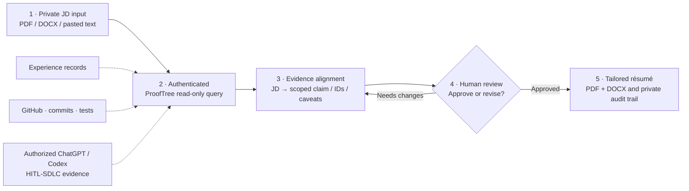

# Design visuals — portfolio change requests

These are **version-controlled conceptual design assets**, not screenshots of live functionality. They capture the useful visual intent of the planning conversation in GitHub-reviewable form.

## CR-001 / ILL-05 — Potty Weekend portfolio card

- [Open scalable SVG](./cr-001-potty-weekend-card.svg)
- [Source and acceptance criteria](../CHANGE-REQUESTS.md#cr-001--feature-potty-weekend-as-a-shipped-product-case-study)
- Status: **illustrative case-study design**, not a real screenshot or an implemented portfolio card. The live [Potty Weekend app](https://potty-weekend.netlify.app/) and [source](https://github.com/jtwray/potty-weekend) exist separately. Mobile QA and real-use claims are limited.

## CR-002 / ILL-06A — résumé access

- [Open scalable SVG](./cr-002-resume-access.svg)
- [Requirement and acceptance criteria](../CHANGE-REQUESTS.md#cr-002--accessible-résumé-formats-without-losing-the-digital-résumé-link)
- Status: **design proposal**. Existing W2 navigation remains; PDF view/download is unimplemented until a reviewed résumé asset is available. Automated recipient delivery is **deferred**.

## CR-003 / ILL-07 — ProofTree résumé tailoring

- [Open scalable SVG](./cr-003-prooftree-resume-flow.svg)
- [Requirement and acceptance criteria](../CHANGE-REQUESTS.md#cr-003--prooftree-evidence-verified-résumé-tailoring-from-a-job-description)
- Status: **future proposal**. This does not demonstrate that a ProofTree query API, website upload, evidence matching, export, or authenticated backend currently exists.

### Editable flow source (Mermaid)

The SVG is useful for PR review, while this Mermaid source makes the workflow straightforward to modify without recreating a screenshot:

> **Security boundary:** Job descriptions and private ProofTree records stay within an authenticated owner-only workflow. Chat/Codex records require explicitly authorized source access and correct human-versus-agent attribution. Unverified claims must not be promoted into output.

## Asset policy

- Prefer **SVG** for accurate, scalable, text-sharp UI concepts; prefer **Mermaid** in Markdown for editable engineering workflows. Use screenshots only for verified running UI or when a third-party source cannot be represented more honestly as source.
- Keep these designs next to the PR/CR documentation, not in the production website `assets/` tree.
- Any future generated illustration or screenshot should include source, version/date, intended claim, and whether it is a **mock**, **implemented UI**, or **verified live behavior**.
- Before replacing a design in a later PR, update the matching SVG and Mermaid, link it from the relevant CR and review its accessibility description.
